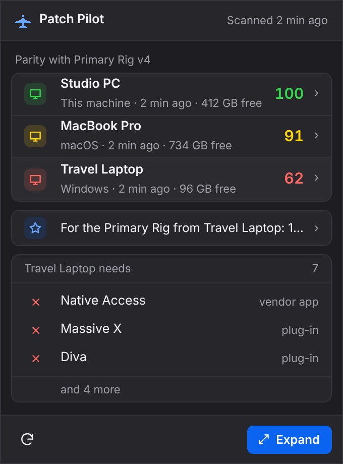
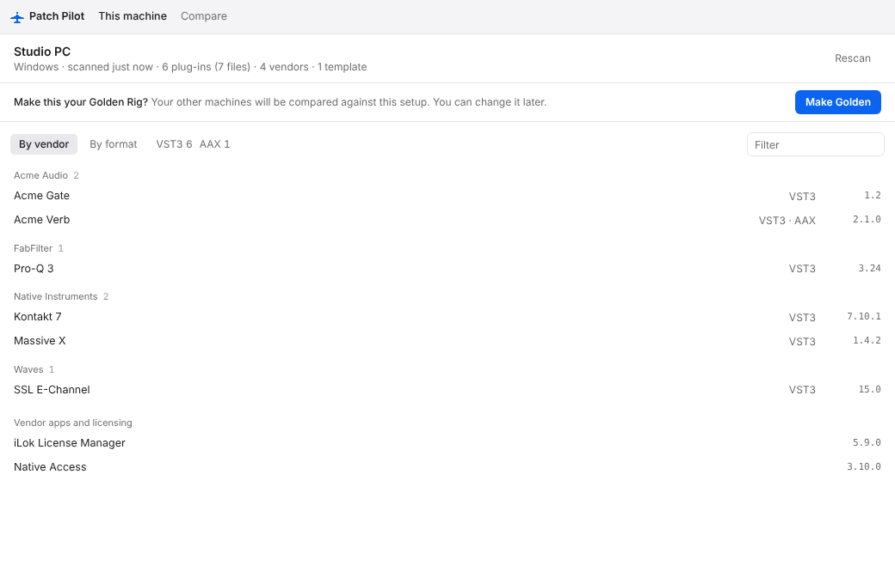
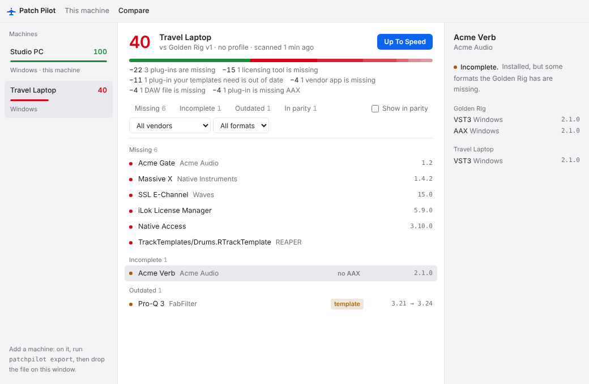
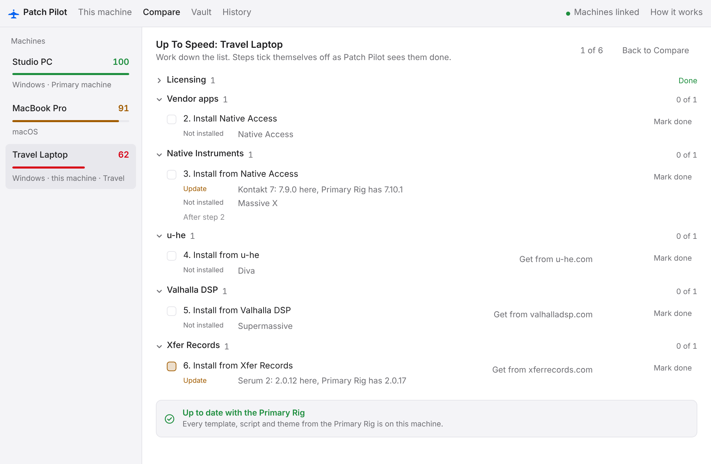

# Patch Pilot

**Every rig, ready.** Patch Pilot keeps all your music machines set up the same way, so a session that opens on your studio PC also opens on your laptop, with every plug-in in place.

For producers, mixers and engineers who work on more than one computer, on Windows and macOS, with Reaper or Ableton Live.



## Download

Get the latest version for Windows or macOS from the **[releases page](https://github.com/PatchPilotSync/patch-pilot-releases/releases/latest)**:

- **Windows:** the file ending in `_x64-setup.exe`.
- **Mac with Apple silicon (M1 to M5):** the file ending in `_aarch64.dmg`. Intel Macs take the `_x64.dmg`.

Install it on every machine you work on. After that it updates itself: when a new version is out, it shows you what's new and installs only when you click. You can also choose **Check for Updates…** from the tray or menu bar icon.

**On a Mac:** the app isn't signed by Apple yet, so macOS may say it's "damaged" and can't be opened. It isn't. Drag it to Applications, then run this once in Terminal:

```sh
xattr -cr "/Applications/Patch Pilot.app"
```

macOS may also ask for your Documents folder once. Click Allow: Patch Pilot watches preset folders there to keep them in sync.

## Why it helps

You know the moment: you open a project on the laptop and half the chain is red because a plug-in is missing, out of date, or only installed on the studio machine. Patch Pilot catches that before the session, not during it.

- **No more missing plug-ins.** See at a glance which plug-ins, versions, vendor apps and DAW templates a machine is missing.
- **One setup to aim for.** Pick your best machine as the Primary Rig. Every other machine is measured against it.
- **Know what to fix first.** A simple checklist tells you what to install, in the right order, with a link to where each thing comes from.
- **Your files follow you.** Templates, scripts, presets and settings you add or change on one machine show up on the others by themselves.
- **Nothing to babysit.** It sits quietly in your menu bar or system tray and notices changes on its own.
- **Safe by design.** It never opens your plug-ins, copies licensed software, deletes your files or runs installers behind your back, and anything it changes on a machine can be undone.

## How it works

1. **Install it on each machine.** Patch Pilot looks at the plug-ins installed there (VST2, VST3, AU, AAX and CLAP), your vendor apps (Native Access, Waves Central, iLok and more), your preset folders, and your Reaper and Ableton Live templates, scripts and settings.
2. **Link your machines.** Click **Link a machine**, show a short code on one machine and type it on the other. From then on each machine sees the others live.
3. **Choose your Primary Rig.** That's your ideal setup. Update it whenever your setup changes; every version is kept.
4. **Compare.** Each machine gets a **parity score** that shows how close it is to the Primary Rig, with the reasons behind the number ("205 plug-ins are missing, −41 points"). A plug-in counts as installed in any format, and a travel laptop can skip things it doesn't need, like AAX or huge sample libraries.
5. **Get Up To Speed.** Patch Pilot turns the differences into a checklist, starting with what other installs depend on, like licensing tools. You install things yourself, and each step ticks itself off a few seconds after the installer finishes.

| Your rig | Compare with the Primary Rig | Get Up To Speed |
| --- | --- | --- |
|  |  |  |

## How syncing works

Patch Pilot moves two kinds of things between your machines, in two different ways. Plug-ins, apps and sample libraries are never uploaded anywhere.

- **What's installed (scan results).** Linked machines share the list of what each one has through a small relay. It's end-to-end encrypted, so nobody else can read it, not even us. There are no accounts.
- **Your own files.** Templates, scripts, presets and settings travel through a cloud folder you already use (Dropbox, OneDrive, Google Drive, iCloud Drive or any folder you pick). If you'd rather, you can use a private GitHub repo of your own instead, under **Use GitHub…** on This machine's Sync & backup line; every change is kept in the repo's history.

Syncing files is careful: a file you delete on one machine stays on the others, an edit made on two machines asks you which copy to keep, and settings only change while Reaper or Live is closed. Under **Choose what syncs** you can keep any kind of file or setting to one machine. The full list is in [docs/what-syncs.md](docs/what-syncs.md).

## Features

- **Primary Rig** — the setup every machine should match, with version history. When a machine has something the Primary Rig lacks, Compare suggests adding it.
- **Parity score** — one number per machine, always with the reasons and the points each one costs.
- **Get Up To Speed and Set up** — a step-by-step checklist to bring a machine back in line, or to set up a new one from scratch, ending with a setup report you can save. Each step says whether something is not installed or needs an update, with both versions.
- **Drift and update alerts** — a quiet notification when a machine falls behind, or when a newer version of a plug-in is on another machine or available from its maker.
- **Template readiness** — tells you which Reaper templates, FX chains and Ableton sets or racks won't open fully on a machine, because a plug-in they use is missing.
- **Keep files in sync** — Reaper templates, FX chains, scripts (with every file they need, including ReaPack packages), themes, shortcuts, menus and mouse modifiers; Ableton Live templates, presets, racks, Max for Live devices, Collections, Places and Options.txt; and plug-in presets from Serum, FabFilter, Valhalla, u-he, Soundtoys and many more. Renames follow too. Reaper shortcuts from a PC are adjusted to work on a Mac.
- **Bring over** — copy another machine's files onto this one by hand, one file, a whole folder or every template at once.
- **Backup** — every template, script, setting and preset backed up to your cloud folder after each change, with earlier versions kept. A new machine can start from another machine's backup.
- **Ignore** — hide anything you don't want on a machine (a plug-in, a file, a folder, a step), on this machine only or everywhere. It leaves the score and every count.
- **Duplicate presets** — find the same preset saved in several folders and clean up the extra copies.
- **Installer Vault** — keep your installers in one folder on your own drive. Patch Pilot spots new ones in Downloads and runs the right one when you click.
- **History and undo** — a restore point before every change Patch Pilot makes to a file, so anything can be undone.
- **Rig Report** — share a list of your plug-ins and score as a web page or text, for forums or collaborators. It never includes file paths or licence details.
- **Always on, barely there** — opens when your computer starts, waits in the tray or menu bar, and rescans by itself when you add or update a plug-in. It uses next to no CPU while it waits.
- **Light and dark** — follows your system setting.

## What Patch Pilot is not

It's not a cloud drive or a license manager, and it never moves plug-ins or sample libraries between machines: only your own small files, like templates, presets and settings. It never signs in to iLok or vendor accounts. It tells you what each machine needs; you stay in control of what gets installed.

## Status

Early preview, with new versions often. Reaper and Ableton Live are supported today. Coming later: a closed alpha and public beta, Apple signing so the Mac warning goes away, and a Pro version. See the roadmap in [docs/strategy.md](docs/strategy.md#22-12-month-roadmap).

---

## For developers

Patch Pilot is a Tauri 2 desktop app (React + TypeScript UI in `app/`) on top of a Rust workspace in `crates/`, with a small Cloudflare Worker relay for live linking in `relay/`.

```sh
cargo test --workspace          # core crates
cd app && npm ci && npm run tauri dev   # the desktop app
```

- [CLAUDE.md](CLAUDE.md) — project rules, layout and build commands
- [app/CHANGELOG.md](app/CHANGELOG.md) — what changed in each version
- [docs/what-syncs.md](docs/what-syncs.md) — exactly what keeps in sync between machines
- [docs/cli.md](docs/cli.md) — the `patchpilot` command-line tool for alpha testers
- [docs/strategy.md](docs/strategy.md) — product strategy, architecture and roadmap
- [docs/decisions.md](docs/decisions.md) — decisions log (authoritative)
- [docs/handoff.md](docs/handoff.md) — what's built and what's next
- [docs/releasing.md](docs/releasing.md) — how to publish a release
- [docs/founders-agreement-checklist.md](docs/founders-agreement-checklist.md) — things to agree in writing

One issue, one branch, one PR, reviewed by the other founder. See CLAUDE.md.

## License

Proprietary. All rights reserved. Not for redistribution.
